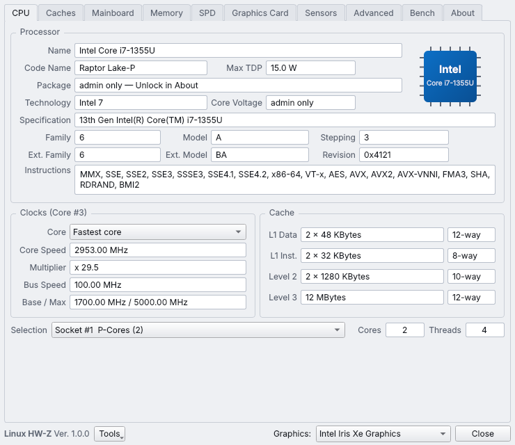
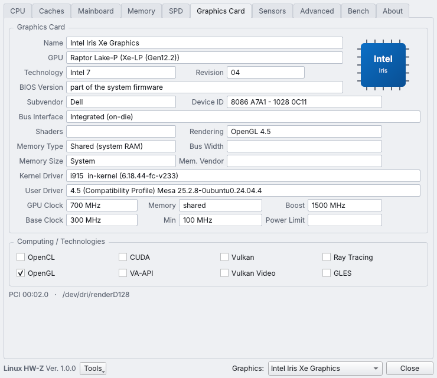
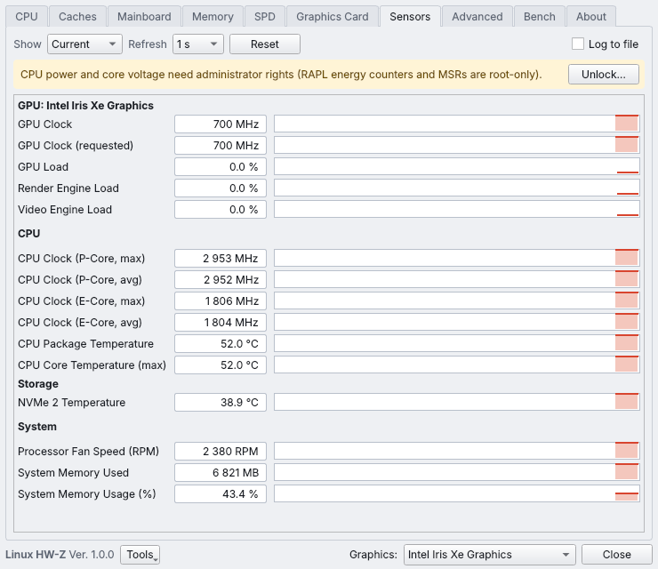

# Linux HW-Z

**CPU-Z and GPU-Z in one window, for Linux.** Processor, caches, mainboard, memory, SPD,
graphics card, live sensors and a CPU benchmark — built for Ubuntu 24.04 and shipped as a
single AppImage.



## Tabs

| Tab | What it shows | Where it comes from |
|---|---|---|
| **CPU** | Name, code name, technology, TDP, package, core voltage, family/model/stepping, instructions, live core clock and multiplier, caches, P-core / E-core selection | CPUID, `/proc/cpuinfo`, cpufreq, RAPL limits, SMBIOS |
| **Caches** | Every cache level with size, instances, associativity, line size and sharing | `/sys/devices/system/cpu/*/cache` |
| **Mainboard** | Manufacturer, model, chipset, southbridge, PCIe bus specs, BIOS/UEFI, Secure Boot, graphics link | DMI, PCI, EFI variables |
| **Memory** | Type, size, channels, slots, speed, JEDEC timings, usage | SMBIOS type 17, SPD, `/proc/meminfo` |
| **SPD** | Per-module size, bandwidth, manufacturer, part/serial, week/year, ranks, XMP/EXPO, JEDEC timing table | DDR3 / DDR4 (ee1004) / DDR5 (spd5118) EEPROMs |
| **Graphics Card** | Name, GPU, technology, BIOS, subvendor, device ID, bus interface, shaders, memory, drivers, clocks, API support | PCI + pci.ids, i915 / xe / amdgpu sysfs, NVML, Vulkan, OpenGL, OpenCL, VA-API, CUDA |
| **Sensors** | GPU-Z style live graphs: GPU clock/load/temperature/power/fan/VRAM, CPU clocks/load/temperature/power/voltage, fans, NVMe, RAM. Current/min/max/average, CSV logging | hwmon, DRM fdinfo, NVML, RAPL, MSR |
| **Advanced** | Vulkan, OpenGL, OpenCL and VA-API details, all CPU flags, every PCI device, full report | |
| **Bench** | Single- and multi-thread score, multi-thread ratio, stress test, previous runs as reference | native kernel in `libhwz.so` |
| **About** | Save report (.TXT / .HTML), copy report, unlock administrator details, theme | |

 

## Administrator details

Everything works as a normal user. A few values are root-only on Linux: the SMBIOS memory
table (slots, type, speed), the CPU package, core voltage (MSR) and CPU/iGPU power (RAPL
energy counters). **About → Unlock administrator details** (or the *Unlock…* buttons) asks
for your password through polkit and starts a small helper (`hwz/helper_root.py`, standard
library only). The helper only reads: it loads the read-only `msr`, `ee1004` and `spd5118`
drivers if needed, sends the SMBIOS table and SPD dumps once, then streams power and voltage
until Linux HW-Z closes.

## Download and run

Download `Linux-HW-Z-1.0.1-x86_64.AppImage` and its `.sha256` from [Releases](https://github.com/demosthenesk/Linux-HW-Z/releases/latest), then:

```sh
sha256sum -c Linux-HW-Z-1.0.1-x86_64.AppImage.sha256
chmod +x Linux-HW-Z-1.0.1-x86_64.AppImage
./Linux-HW-Z-1.0.1-x86_64.AppImage
```

The AppImage bundles a pruned Qt 6.8 (PySide6) with the xcb and Wayland platform plugins and
uses the system `python3` (3.12 on Ubuntu 24.04; any 3.9+ works).

Command line:

```sh
./Linux-HW-Z-1.0.1-x86_64.AppImage --report report.html   # or .txt, or '-' for stdout
./Linux-HW-Z-1.0.1-x86_64.AppImage --tab Sensors --theme dark
```

Optional packages for more information: Vulkan works with any Mesa or NVIDIA
driver; `intel-opencl-icd` or `mesa-opencl-icd` for OpenCL; `intel-media-va-driver` /
`mesa-va-drivers` for VA-API video profiles.

## Run from source

```sh
sudo apt install python3-pip python3-venv gcc hwdata
python3 -m venv .venv && .venv/bin/pip install PySide6-Essentials==6.8.1
gcc -O2 -fPIC -shared -o hwz/native/libhwz.so hwz/native/libhwz.c
.venv/bin/python -m hwz
```

Build the AppImage on Ubuntu 24.04 with `packaging/build-appimage.sh`.

## Testing without the hardware

`tests/make_fake_root.py` builds fake `/sys` + `/proc` trees (Core i7-1355U laptop with Iris Xe and
DDR4, Ryzen 7 7700X with Radeon RX 6800 and DDR5, and the same desktop with an RTX 4070).
Point the program at one with `HWZ_ROOT=/path/to/tree`; `tests/fake_nvml.c` stands in for NVML.
`tests/ui_smoke.py` drives every tab, the helper, the benchmark and the reports headlessly.
The screenshots above were made that way, from the simulated Inspiron 15 3530 profile.

## Changelog

- **1.0.1:** Mainboard → Graphic Interface no longer shows empty link fields for an on-die GPU (such as
  Intel Iris Xe). It says there is no PCIe link and shows the shared memory and clock range instead.
- **1.0.0:** first release.

## License

MIT © 2026 Demosthenes Koptsis. CPU-Z and GPU-Z are trademarks of their owners; Linux HW-Z is an
independent program and uses none of their code or artwork. The bundled `pci.ids` is from the
PCI ID Repository (BSD-3-Clause / GPL-2.0).
